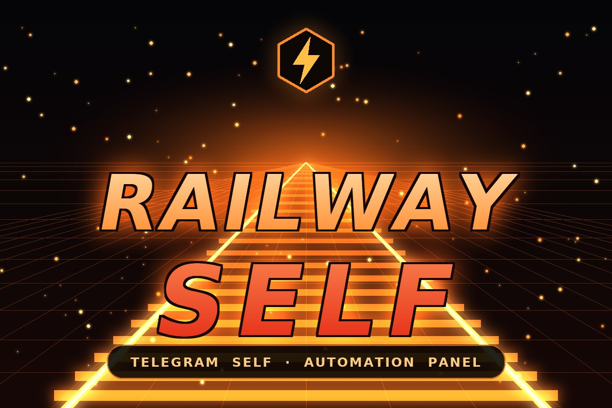

<div align="center">



# ⚡ Railway Self

### Your Telegram. Your controls. One powerful self-userbot.


<br>


</div>

---

## ✨ What is Railway Self?

A feature-rich Telegram self-userbot with a web dashboard, colorful inline controls, automation tools, optional multi-user hub, and a multi-provider AI center — designed to run on Railway.

## 🚀 Highlights

| Feature | Description |
|---|---|
| 🎛️ Web Dashboard | Sign in and manage your Telegram session from a browser |
| 🎨 Inline Panel | Image-based control panel with colored buttons and paginated commands |
| ⚙️ Automation | Scheduled actions, chat tools, profile utilities and configurable automations |
| 🐾 MeowAce Tools | Optional game helpers, status tracking and scheduling |
| 🧠 AI Center | Connect supported AI providers through environment variables |
| 👥 Multi-user Hub | Optional shared bot for separate user instances |
| 🔄 File Updates | Optional controlled updates without a full Railway redeploy |
| 💾 Backup & Restore | Export and restore supported settings |

## 🖥️ Deploy on Railway

1. Fork or upload this repository to a **private GitHub repository**.
2. In Railway, create a project and deploy from that repository.
3. Add the environment variables below.
4. Create a persistent Volume and set its mount path to `/data`.
5. In **Settings → Networking**, generate a public domain.
6. Open the domain and complete the setup flow.

### Required variable

| Variable | Purpose |
|---|---|
| `PANEL_PASSWORD` | Password for the web dashboard |

### Optional variables

| Variable | Purpose |
|---|---|
| `API_ID`, `API_HASH` | Your Telegram API credentials; setup may also request them in the dashboard |
| `TIMEZONE` | Time zone; default: `Asia/Tehran` |
| `PANEL_TTL` | Inline panel lifetime in seconds; default: `300` |
| `AI_MODEL` | Preferred AI model |
| `OPENAI_API_KEY`, `GEMINI_API_KEY`, `ANTHROPIC_API_KEY`, `DEEPSEEK_API_KEY`, `GROQ_API_KEY`, `OPENROUTER_API_KEY` | Optional AI provider keys |
| `AI_BASE_URL`, `AI_API_KEY`, `AI_CUSTOM_MODEL` | Optional OpenAI-compatible endpoint |

Never commit passwords, API keys, bot tokens, or Telegram session files to GitHub.

## 🎮 Quick start

After deployment, open your Railway domain and follow the login flow:

1. Enter your dashboard password.
2. Provide Telegram API credentials if requested.
3. Enter your phone number and complete Telegram verification.
4. Open Telegram and send `.راهنما` to view available commands.
5. Send `.پنل` to open the inline control panel.

### Colorful Telegram panel

1. Create a bot with [@BotFather](https://t.me/BotFather).
2. Enable inline mode using `/setinline`.
3. Add the bot token in the dashboard.
4. Start the bot once, then send `.پنل` from your Telegram account.

The panel supports navigation, feature details, toggles and automatic expiration. Button styling depends on Telegram client support.

## 🧩 Useful commands

| Command | Action |
|---|---|
| `.راهنما` | Show command help |
| `.پنل` | Open the control panel |
| `.وضعیت` | Show runtime and connection status |
| `.گزارش` | Show supported activity statistics |
| `.پشتیبان` | Export supported settings |
| `.بازیابی` | Restore settings from a backup file |
| `.فرمت quote` | Enable quote-style message formatting |
| `.فرمت off` | Disable quote-style formatting |
| `.هوش status` | Show AI provider status |
| `.هوش سوال شما` | Send a prompt to the selected AI provider |

Use `.راهنما` inside Telegram for the full command list and usage examples.

## 🧠 AI Center

The dashboard can show configured providers and let you select a provider/model. Supported integrations include OpenAI, Anthropic, Gemini, DeepSeek, Groq, OpenRouter and other compatible services.

Add provider keys through Railway Variables. Keys are intended to remain in environment variables and should never be pasted into public source files.

## 👥 Optional multi-user hub

The shared hub can be enabled with Railway variables:

- `HUB_BOT_TOKEN` — token for the shared Telegram bot.
- `HUB_ADMIN_ID` — numeric Telegram ID of the administrator.
- `HUB_OPEN` — whether new registrations are open (`1` or `0`).
- `HUB_TRIAL_DAYS` — optional trial duration.
- `MAX_USERS` — maximum number of user instances.
- `HUB_DOMAIN` — public Railway domain for web and mini-app access.

Keep registration restricted unless you are prepared to operate and support multiple user sessions. Review the access and data implications before enabling this mode.

## 🛡️ Security & privacy

> **Important:** This project handles Telegram login sessions. Anyone who can access the server, its persistent Volume, or its administrative credentials may be able to access session data.

- Use a private repository and strong, unique dashboard password.
- Store secrets only in Railway Variables.
- Restrict access to the Railway project and its Volume.
- Only enable file-based updates if you understand the risks of executing uploaded code.
- Tell every hub user how their session data is stored and who can administer the server.
- Use automation responsibly and follow Telegram's rules. Excessive activity may lead to rate limits or account restrictions.

## 📁 Project structure

```text
.
├── main.py          # Web dashboard and application entry point
├── core.py          # Core configuration and feature registry
├── features.py      # Telegram commands and features
├── meow.py          # MeowAce automation helpers
├── botpanel.py      # Inline control panel
├── hub.py           # Optional multi-user hub
├── miniapp.py       # Telegram mini-app
├── boot.py          # Startup routines
├── updater.py       # Optional file update manager
├── assets/          # Images and visual assets
├── fonts/           # Fonts
├── tools/           # Asset utilities
├── requirements.txt
└── Procfile
```

## 💜 Credits

Built for Telegram automation and Railway deployment. If you find an issue, include the relevant log excerpt and steps to reproduce it — never share session files, login codes, passwords, or API keys.

<div align="center">

**Made with ⚡ for Telegram power users**


</div>
